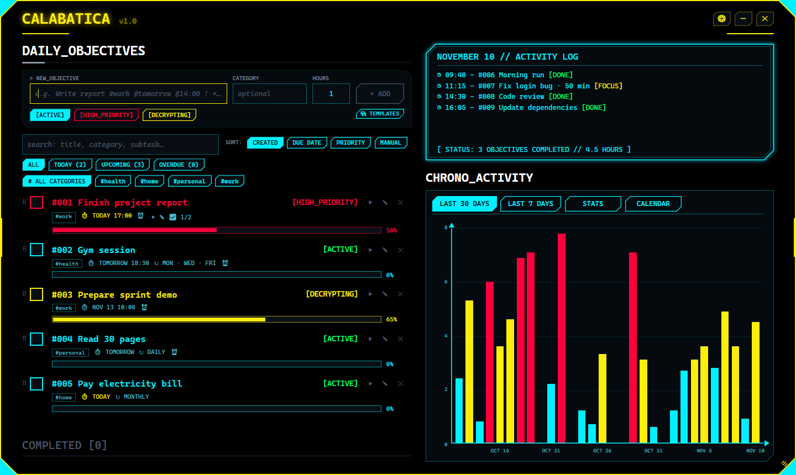
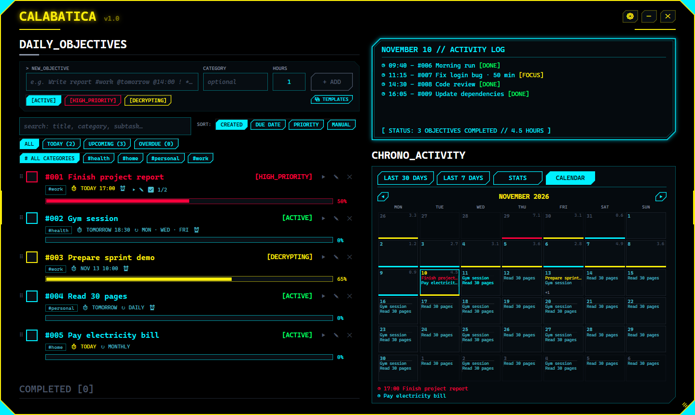
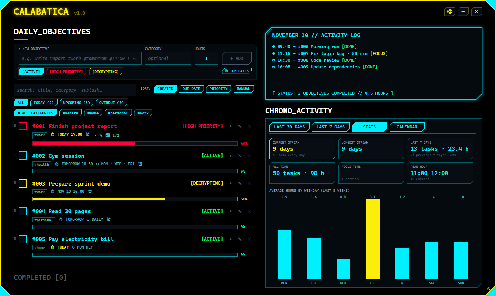
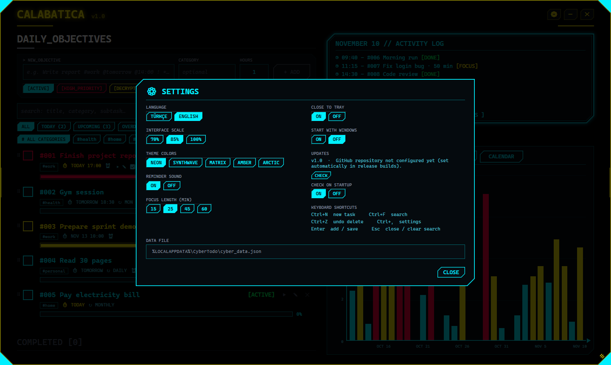
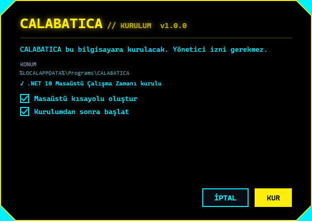

<p align="center">
  
</p>

<h1 align="center">CALABATICA</h1>

<p align="center">
  A neon HUD-style to-do list and activity tracker for Windows.
</p>

<p align="center">
  
  
  
  
</p>

> **Fan project.** CALABATICA's interface is inspired by the UI aesthetic of **Cyberpunk 2077**.
> It is a non-commercial fan project and is **not affiliated with, endorsed by, or connected to CD PROJEKT RED**.
> Cyberpunk 2077 is a registered trademark of CD PROJEKT S.A. No game assets (images, logos, sounds or fonts)
> are used in this project; all graphics are original.



## Features

**Tasks**
- Natural-language quick add: `Write report #work @tomorrow @14:00 ! *weekly ~2`
- Priorities, categories, due dates and times, notes, subtasks with automatic progress
- Repeat daily, weekly, monthly or on **selected weekdays** (e.g. Mon/Wed/Fri, weekdays, weekend)
- Reminders (on time, 15 min, 1 h or 1 day before) with snooze (10 min / 1 h)
- Search, smart lists (Today / Upcoming / Overdue), category filters and **saved views** (one click restores search + category + list)
- Sort by creation, due date or priority, or reorder by **drag and drop**
- Templates: save the visible tasks as a reusable set
- Undo the last action (add, complete, reopen, edit, move, delete, apply template) with `Ctrl+Z` or the ↶ button

**Focus and insights**
- Built-in focus (Pomodoro) timer per task; tracked time goes into your daily activity
- Breaks after each focus (5 min, 15 min after every 4th), optional auto-start of the next focus
- Habits: streaks, best streak, 30-day rate and a 28-day strip for every recurring task
- Activity log and a 30 / 7-day chart (hover a bar to see that day)
- Stats: current and longest streak, weekly comparison, peak hour, average by weekday
- Focus stats: time per category and per task over the last 7 or 30 days
- Month calendar with recurring tasks projected onto future days

**App**
- Turkish and English interface
- Five color themes (Neon, Synthwave, Matrix, Amber, Arctic) plus a high-contrast theme that follows Windows high contrast automatically; three UI scales
- Short first-run guide (reopen any time with ?)
- Runs in the system tray with Windows notifications; optional start with Windows
- Mini mode (`Ctrl+M`): small always-on-top window with the timer and today's tasks
- Updates itself from GitHub Releases: downloads the new version, verifies its SHA256 checksum and restarts
- Daily automatic backups (last 7 kept), one-click restore, JSON / CSV (Excel) export and JSON import
- Completed tasks older than 400 days move to yearly archive files, so the data file stays small; totals are kept
- Local crash reports and error log in %LOCALAPPDATA%\CyberTodo\logs (nothing is sent anywhere)
- Export tasks with due dates to Google Calendar, Outlook or Apple Calendar (`.ics`)
- Data stays on your computer (`%LOCALAPPDATA%\CyberTodo\cyber_data.json`), no account and no telemetry

| Calendar | Stats |
|---|---|
|  |  |

| Settings | Setup |
|---|---|
|  |  |

## Quick add syntax

Type a task in the "new objective" box and press `Enter`. Commands start with a symbol, so normal words in a title are never mistaken for a date.

| Command | Meaning | Example |
|---|---|---|
| `#name` | Category | `#work` |
| `!` | High priority | `!` |
| `@today` `@tomorrow` `@friday` `@25.11` | Due date | `@friday` |
| `@HH:MM` | Due time (today if no date) | `@14:00` |
| `*daily` `*weekly` `*monthly` | Repeat | `*weekly` |
| `*weekdays` `*weekend` `*mon,wed,fri` | Repeat on selected days | `*mon,wed,fri` |
| `~hours` | Estimated hours | `~1.5` |

Turkish words work too (`@yarın`, `*haftalık`, `*pzt,çar,cum`, …).

## Keyboard shortcuts

| Keys | Action |
|---|---|
| `Ctrl+N` | Focus the new task box |
| `Ctrl+F` | Search |
| `Ctrl+Z` | Undo last action |
| `Ctrl+,` | Settings |
| `Enter` | Add / save |
| `Esc` | Close dialog / clear search / leave a text box |
| `↑` `↓` `Home` `End` | Select a task |
| `Space` / `Enter` / `Del` | Complete / edit / delete the selected task |
| `F` | Start or stop focus on the selected task |
| `Ctrl+M` | Mini mode |

## Install

Releases are not published yet. For now, build from source.

The installer (`CALABATICA-Setup-x.y.z.exe`, under 1 MB) installs per user without admin rights. If the
**.NET 10 Desktop Runtime** is missing, it downloads Microsoft's official installer, verifies its Microsoft
signature and installs it. The installer UI follows the Windows display language (Turkish or English).

## Build from source

Requirements: Windows 10/11 and the [.NET 10 SDK](https://dotnet.microsoft.com/download).

```powershell
# Run the app
dotnet run --project CyberTodo/CyberTodo.csproj

# Build the installer -> artifacts/CALABATICA-Setup-1.0.0.exe
./build-installer.ps1 -Version 1.0.0

# Run the tests (exit code = number of failed tests)
dotnet run --project tests/CalabaticaTests -c Release
```

The tests use a temporary folder, a manual clock and fake network/dialogs; they never touch your real data, the registry or the network.
A UI smoke test opens the real window off-screen (it never takes focus), visits every tab and panel and fails on any WPF binding error.
Set CALA_UI_SHOTS to a folder to also get a PNG of every screen.
CI (`.github/workflows/ci.yml`) builds the app and runs the tests on every push and pull request.

See [RELEASING.md](RELEASING.md) for versioning and the release workflow.

## Project structure

```
CyberTodo/              WPF app (MVVM, CommunityToolkit.Mvvm)
  Models/               Tasks, days, settings, themes, templates, saved views
  Services/             Storage + schema migrations, backups, archive, export (CSV/ICS),
                        update check/installer, localization, startup, crash log
  ViewModels/           MainViewModel split by feature (MainViewModel.Tasks.cs, .Focus.cs, .Data.cs, …),
                        FocusTimer (focus/break state machine), editor, quick-add parser, insights
  Views/                Panels and overlays as user controls (stats, focus, habits, calendar, settings, …)
  Themes/Theme.xaml     Shared palette, styles and templates (loaded at application level)
  MainWindow.xaml       Shell: header, task list, chart, toasts (no third-party UI or chart libraries)
  MiniWindow.xaml       Always-on-top mini mode
  TrayIconHost.cs       System tray icon and notifications
Installer/              Themed setup program (.NET Framework 4.8)
tests/CalabaticaTests/  Dependency-free test runner
build-installer.ps1     Builds the app and the installer
.github/                CI, release workflow (version tags only), Dependabot; actions pinned to commit SHAs
```

## Tech notes

- C# 14, .NET 10, WPF, MVVM with `[ObservableProperty]` / `[RelayCommand]` source generators
- The chart, calendar and HUD frames are drawn with plain WPF elements; no chart library
- Glow effects are limited to two static elements to keep list rendering fast
- Task lists are virtualized: 2,500 tasks load in about 1 second
- Add / complete / delete update the list views incrementally instead of re-sorting everything
  (2,500 tasks, median incl. layout: add 75 → 4 ms, complete 100 → 20 ms)
- Time comes from an injected TimeProvider, so focus, breaks, reminders and midnight are tested with a manual clock
- ReadyToRun was measured and left off: ~5 % less startup CPU, no measurable wall-clock gain, twice the exe size
- Software rendering is the default: with 2,500 tasks the shown window uses ~150 MB instead of ~265 MB (private 97 vs 212 MB)
  at the same CPU (hover/scroll/idle measured in both modes); the GPU path only added a D3D device and surfaces.
  Set `CALABATICA_RENDER=gpu` to switch back (e.g. on a very high-resolution display)
- When the window is hidden to the tray (and mini mode is off) the process trims itself once after 8 s:
  working set ~270 MB -> ~15-40 MB (pages return on demand; reserved memory drops less)
- Measured and left alone: GC settings (`gcConcurrent`, conserve-memory), `TieredPGO` and removing the glow effects
  (no memory change; startup within noise)- Saves are coalesced (400 ms), serialized on the UI thread and written atomically (temp file + move);
  pending changes are flushed on exit and when Windows signs out
- Backups are written from an in-memory snapshot to `backups\` next to the data file; restore and import
  always back up the current state first

## License

[MIT](LICENSE) © 2026 SAMET KAŞMER
